**Mathematics & Computing undergrad building low-latency systems and numerical software in modern C++23.**

---

## About

I'm a Second-year B.Tech student in Mathematics and Computing at RGIPT. Most of my engineering time goes into systems software in C++23: workflow engines, numerical libraries, and trading infrastructure.

I like working on the layer underneath research and trading systems, and I build things from scratch to understand every layer instead of treating libraries as black boxes. Performance claims in my repos are backed by benchmarks, not intuition.

## Projects

### [FlowForge](https://github.com/amoralpha/FLowforge)

High-performance C++23 workflow orchestration engine: DAG-based task scheduling, parallel execution, failure handling, and content-based caching. Developed incrementally from v0.1 towards v1.0.

### [Neuroforge](https://github.com/amoralpha/Neuroforge)

Numerical computing library built from first principles in modern C++23. It is the numerical foundation for my other projects.

| Module | Status |
|---|---|
| Matrix | In progress |
| Linear Algebra | In progress |
| Numerical Computing | Planned |
| Machine Learning Foundation | Planned |

### [Blazebook](https://github.com/amoralpha/blazebook)

Low-latency electronic trading infrastructure in C++23, starting from the limit order book and matching engine.

| Module | Status |
|---|---|
| Limit Order Book | In progress |
| Matching Engine | Planned |
| Market Data Feed | Planned |
| Execution & Risk | Planned |
| Backtesting & Benchmark Suite | Planned |

### [Distributed Benchmarking Platform](https://github.com/amoralpha/distributed-benchmarking-platform)

Benchmarking platform for trading infrastructure (JavaScript).

## Current Focus

- Taking FlowForge through its v0.x releases
- Linux systems and concurrency for low-latency work: sanitizers, epoll, atomics, profiling
- Competitive programming (Codeforces)
- Probability, stochastic processes and optimization for quantitative finance
- Machine learning fundamentals

## How I Work

- Correctness first, then optimization, justified by benchmarks
- Small, reviewable commits over big opaque ones
- Tests and documentation are part of the deliverable
- Code is written for the next person reading it

## Tech Stack

## Contact

- Email: [ritikmishramishra49@gmail.com](mailto:ritikmishramishra49@gmail.com)
- LinkedIn: [linkedin.com/in/ritik-mishra-401b5a370](https://www.linkedin.com/in/ritik-mishra-401b5a370)
- Codeforces: [amor2](https://codeforces.com/profile/amor2)

---

Building in the open.

